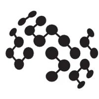
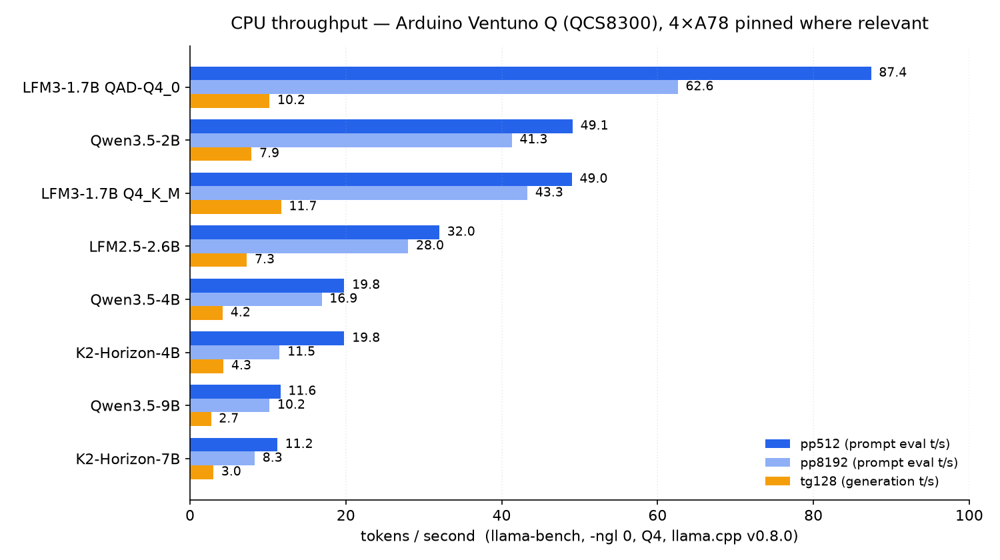
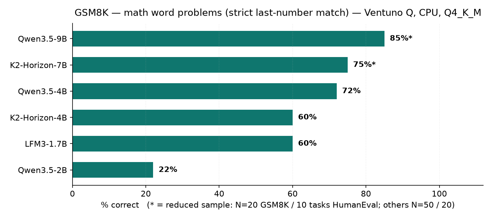
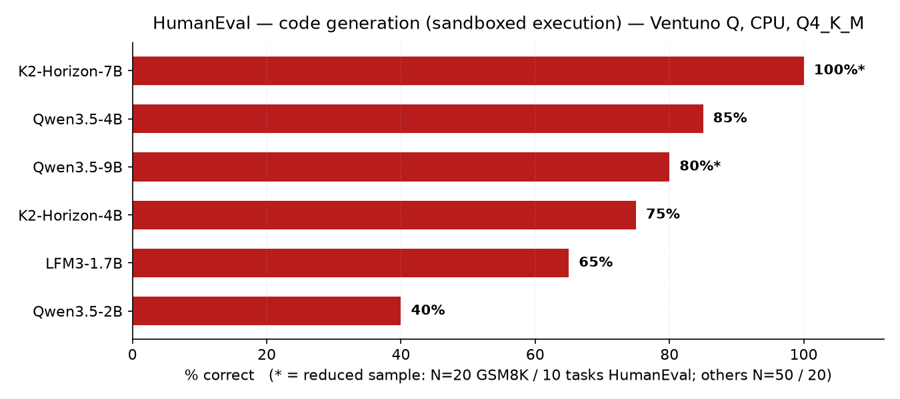
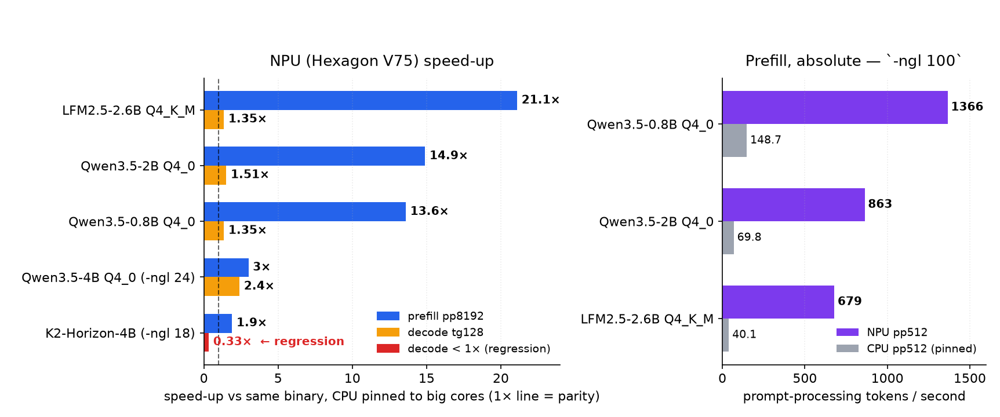

# ventunoq-llamacpp

**llama.cpp on the Arduino Ventuno Q (Qualcomm QCS8300) — every accelerator, measured,
with every failure root-caused.**

Started as a Liquid AI **LFM3** evaluation (announced 2026-10-27) and grew into a
full engine survey of the board: CPU, Hexagon NPU (two independent stacks), and the
Adreno GPU via Vulkan/Turnip. Two engines work and are benchmarked; two paths are
blocked, each with a reproducible root cause, evidence, and a concrete fix path.

## Engine status at a glance

| Engine | Stack | Status | Evidence |
|---|---|---|---|
| **CPU** (4×A78 + 4×A55, NEON+dotprod) | llama.cpp v0.8.0 prebuilt (`armv8.2_2`) | ✅ **works** — baseline for everything | [BENCHMARKS §1–2](BENCHMARKS.md) |
| **NPU** (Hexagon V75 HTP) | Arduino `llamacpp/20261020` runner — upstream **Hexagon backend** over classic fastrpc | ✅ **works** — prefill **9–21×** CPU, decode 1.35–1.5×, quality parity, ≤ ~1.75 GiB NPU-side | [BENCHMARKS §3](BENCHMARKS.md) |
| **NPU via QNN/QAIRT** | Qualcomm AI Runtime 2.51, HTP skel | ❌ **blocked** — kernel lacks the vendor `smmu_proxy` service (`HAP_mmap2` → `paddr 0x0`) | [FAILURES F1](FAILURES.md) |
| **GPU** (Adreno 623, Turnip/Mesa 25.2.8, Vulkan 1.3) | llama.cpp v0.8.0 `-DGGML_VULKAN=ON` | ❌ **blocked** — shaders demand `storageBuffer8BitAccess` the device doesn't advertise; driver segfaults instead of erroring | [FAILURES F2](FAILURES.md) |

Headline results (details in [BENCHMARKS.md](BENCHMARKS.md)):

- **LFM3-1.7B is the best sub-3B model on this board**: 49 pp / 11.7 tg t/s,
  60% GSM8K / 65% HumanEval — near-triple Qwen3.5-2B's quality at equal prefill.
- **The NPU is real and worth it**: LFM2.5-2.6B-Q4_K_M prefills at **679 t/s**
  (572 @8k) vs 40 t/s on a pinned CPU core set — 21×; and GSM8K parity holds
  (NPU 60.0% vs CPU 55.0%, N=20 — one question apart).
- **Decode is bandwidth-bound on every engine** (one shared 16 GiB LPDDR):
  the NPU buys 1.35–1.5× on decode, no more.
- **One hard NPU limit**: the CDSP maps through a **32-bit IOMMU window measured
  at ~1.75 GiB** (`npu/cumap_probe.c`) — full offload works up to ~2B-class Q4;
  K2-Horizon-4B aborts mid-load.

## Model lineup

| | Company | What was tested | License |
|---|---|---|---|
|  | **Liquid AI** | LFM3-1.7B (Q4_K_M + QAD-Q4_0), LFM2.5-2.6B-Q4_K_M | LFM Open License v1.0 |
|  | **Qwen (Alibaba)** | Qwen3.5-0.8B / 2B / 4B / 9B | per model repo |
|  | **unsloth** | — the quantizer behind every Qwen3.5 file here (official `Qwen/*-GGUF` are gated, 401) | mirrors upstream |
|  | **K2 Lab** (HF org `IFM`) | K2-Horizon-4B (repo name: 3.7B), K2-Horizon-7B | Apache-2.0 |

## Results at a glance

Full matrices, method notes and raw-data pointers: [BENCHMARKS.md](BENCHMARKS.md).
Charts are rendered by [`scripts/make_charts.py`](scripts/make_charts.py) (matplotlib).

### CPU — throughput & quality (llama-bench `-ngl 0`, Q4, this board)

| | Model | pp512 | pp8192 | tg128 | GSM8K | HumanEval |
|---|---|---|---|---|---|---|
|  | LFM3-1.7B Q4_K_M | 49.0 | 43.3 | **11.7** | 60.0% | 65% |
|  | LFM3-1.7B **QAD**-Q4_0 | **87.4** | **62.6** | 10.2 | — | — |
|  | LFM2.5-2.6B | 32.0 | 28.0 | 7.3 | — | — |
|  | Qwen3.5-2B | 49.1 | 41.3 | 7.9 | 22.0% | 40% |
|  | Qwen3.5-4B | 19.8 | 16.9 | 4.2 | 72.0% | 85% |
|  | Qwen3.5-9B | 11.6 | 10.2 | 2.7 | 85.0%\* | 80%\* |
|  | K2-Horizon-4B | 19.8 | 11.5 | 4.3 | 60.0% | 75% |
|  | K2-Horizon-7B | 11.2 | 8.3 | 3.0 | 75.0%\* | **100%**\* |

\* reduced sample (GSM8K N=20, HumanEval 10 tasks); others N=50 / 20 tasks.







### NPU — speed-up over the *same binary* pinned to the big cores



† partial offload `-ngl 24` (fits the ~1.75 GiB DSP budget)   ‡ `-ngl 18` ping-pongs (FAILURES F4)

Decode gains stay small on purpose: every engine shares one 16 GiB LPDDR, so decode is
bandwidth-bound everywhere ([`research/memory-map.md`](research/memory-map.md)).
Quality is unaffected by the NPU: GSM8K 60.0% (NPU) vs 55.0% (CPU), N=20 — one question apart.

## Quick start (what works today)

```bash
# CPU — llama-server on the vendored v0.8.0 binaries (LFM3 needs ≥ v0.8.0):
scripts/serve.sh models/LFM3-1.7B-Q4_K_M.gguf          # port 8181

# CPU — best interactive flags on this board (big-core pinning, +75% decode):
llama.cpp/llama-bench -m <gguf> -ngl 0 -t 4 --cpu-mask 0xf --cpu-strict 1

# NPU — Arduino's hexagon runner (fetch + env recipe: research/bricks-faster-inference.md):
export LD_LIBRARY_PATH=/tmp/opencode/libfix:$PKG/lib ADSP_LIBRARY_PATH=$PKG/lib
export GGML_HEXAGON_OPBATCH=2048 GGML_HEXAGON_MBUF=256,256
$PKG/bin/llama-server -m <gguf> -ngl 100 -c 8192 -t 4 --cpu-mask 0x0f -b 1024 -ub 512 -fa on

# Reproduce the NPU benchmark cycles / quality parity check:
scripts/test_hexagon.sh && scripts/test_hexagon2.sh && scripts/eval_hex_quality.sh
```

Model sources used (Q4 quants; official `Qwen/*-GGUF` are gated, so **unsloth** mirrors
were used for Qwen): `LiquidAI/LFM3-1.7B-GGUF`, `LiquidAI/LFM2.5-2.6B-GGUF`,
`unsloth/Qwen3.5-{0.8B,2B,4B,9B}-GGUF`, `IFM/K2-Horizon-{3.7B,7B}-GGUF`.
Disk policy: every GGUF deleted immediately after its tests — full sha256+`df` audit
trail in `results/DISK_LOG.md`.

## The board

| | |
|---|---|
| SoC | Qualcomm QCS8300 "Monza" (Arduino Ventuno Q), Linux 6.8.0-1084-qcom, Ubuntu 24.04.5 aarch64 |
| CPU | 4× Cortex-A78-class @2.36 GHz + 4× Cortex-A55 @1.96 GHz; ARMv8.2 dotprod, **no** SVE/i8mm/bf16 |
| NPU | Hexagon **V75** HTP; FastRPC nodes open to the `arduino` user (no sudo anywhere in this project) |
| GPU | Adreno 623 via **Turnip** (Mesa 25.2.8, Vulkan 1.3.318, headless on `renderD128`) |
| RAM | 16 GiB unified LPDDR (~14.9 GiB to Linux) — **no VRAM, no NPU RAM**; memory topology in `research/memory-map.md` |

## FAQ & Troubleshooting

**Q: The NPU gives 21× on prefill but barely moves decode. Why?**
All engines share one 16 GiB LPDDR pool — there is no NPU RAM. Decode reads every weight
byte once per token, so it saturates shared bandwidth on CPU *and* NPU alike. The NPU's
real win is prompt processing and long-context RAG. (`research/memory-map.md`)

**Q: Which quant should I run?**
Q4_K_M for interactive quality; Q4_0 (or LFM3 **QAD**) when prefill dominates — QAD is
×1.8 prefill for +1.6 perplexity. q2_K/q3_K and token embeddings stay CPU-side even at
`-ngl 100`; that's by design in the Hexagon backend's repack path.

**Q: NPU run dies mid-load at `-ngl 100` on a 3 GB+ model?**
The CDSP maps through a 32-bit IOMMU window measured at **~1.75 GiB** (FAILURES F3;
reproduce with `npu/cumap_probe.c`). Keep the NPU-side footprint under that — step `-ngl`
down, or stay on CPU. Full offload works up to ~2B-class Q4.

**Q: Partial NPU offload is *slower* than plain CPU?**
Per-token CPU↔NPU ping-pong (FAILURES F4 — K2-4B `-ngl 18`: 2.6 t/s vs 7.9 on CPU).
Rule: offload fully, or keep ≥⅔ of the layers on the NPU. Qwen-4B `-ngl 24` is the one
partial config that pays (10.3 t/s); K2-4B partial never does — use CPU.

**Q: The hexagon runner rejects `--device CPU`?**
Known runner quirk. For CPU controls on that binary use `-ngl 0` (what all §3 baselines do).

**Q: `libcdsprpc.so` not found / FastRPC init fails?**
The runner ships only the versioned lib — create the unversioned symlink, and export both
paths: `LD_LIBRARY_PATH=/tmp/opencode/libfix:$PKG/lib` **and** `ADSP_LIBRARY_PATH=$PKG/lib`
(full recipe + sha256: `research/bricks-faster-inference.md`). Also check group membership
(`fastrpc`).

**Q: Vulkan build SIGSEGVs the moment a model loads?**
That's FAILURES F2, not your config: Turnip doesn't advertise `storageBuffer8BitAccess`
that llama.cpp shaders require, and the driver faults instead of returning a validation
error. **There is no userspace workaround.** Diagnose with `test-backend-ops` (expect:
f32-vec 33/33 OK, `mul_mm` GPU fault, `mul_mat_vecq` SIGSEGV). Re-run
`scripts/test_vulkan.sh` to verify any future fix (llama.cpp #6401 / Mesa).

**Q: QNN/QAIRT fails with err 6001 / `HAP_mmap2` → `paddr 0x0`?**
The board's kernel lacks the vendor `smmu_proxy` service (FAILURES F1) — nothing in
userspace can fix it. Classic FastRPC MMAP *does* work (`npu/mmap_probe.c`), which is why
the upstream Hexagon backend runner is the working NPU path.

**Q: `Qwen/*-GGUF` returns 401?**
Official Qwen GGUF repos are gated. Use the **unsloth** mirrors (`unsloth/Qwen3.5-*-GGUF`) —
same quant recipes, public.

**Q: Decode feels slow / numbers bounce between runs?**
Pin the big cores: `-t 4 --cpu-mask 0xf --cpu-strict 1` (+75% decode vs default `-t 8`).
9B/7B-class models are swap-adjacent on 16 GiB — shrink `-c` or drop to ≤4B. Ignore
`-pg` rows with tiny N (tg32 artifact, FAILURES F7).

**Q: Vulkan shader compile fails when building?**
`apt install glslang-tools glslc libvulkan-dev spirv-headers libshaderc1` (the board
already has them).

## Reproduction guide

```bash
# 0. Debian deps (only needed to build; every measurement here ran sudo-free)
sudo apt install -y cmake ninja-build glslang-tools libvulkan-dev spirv-headers glslc libshaderc1

# 1. CPU engine — llama.cpp v0.8.0 b11972, Ubuntu-arm64 prebuilt → ./llama.cpp/
#    exact URL + sha256: ROADMAP.md

# 2. NPU engine — arduino/app-bricks-py GitHub release, tag llamacpp/20261020
#    fetch + sha256 + libcdsprpc symlink + env vars: research/bricks-faster-inference.md

# 3. Models — one at a time; delete each right after its suite; keep / <50%.
#    Log sha256 + `df` per file into results/DISK_LOG.md (the audit trail).
#      LiquidAI/LFM3-1.7B-GGUF · LiquidAI/LFM2.5-2.6B-GGUF
#      unsloth/Qwen3.5-{0.8B,2B,4B,9B}-GGUF · IFM/K2-Horizon-{3.7B,7B}-GGUF

# 4. Suites — each writes CSV/logs into results/ and drops a *_done marker
scripts/bench_suite.sh && scripts/eval_suite.sh       # CPU matrix, pinning, long-ctx, quality
scripts/test_hexagon.sh && scripts/test_hexagon2.sh   # NPU cycles + same-binary CPU controls
scripts/eval_hex_quality.sh                           # NPU↔CPU GSM8K parity
scripts/test_vulkan.sh                                # GPU gate — stays red until ROADMAP R2 lands

# 5. Check
ls results/*_done     # suite_done eval_done hex_done hex2_done hexq_done k2_done k2_4b_done

# 6. Optional — re-render the README charts from the same numbers (pip install matplotlib)
python3 scripts/make_charts.py
```

Datasets (`bench/gsm8k/test.jsonl`, `bench/HumanEval.jsonl`) and the eval harnesses are in
the repo, so steps 4–5 are fully self-contained once the binaries and a GGUF are on disk.

## Repository map

```
README.md            this file
BENCHMARKS.md        everything that works, with numbers + raw-data pointers
FAILURES.md          every failed pathway: symptom → root cause → evidence → status
ROADMAP.md           what is needed to make each blocked thing work (per engine)
docs/REPORT.md       the original chronological field log (2026-10-28/29), kept as-is
scripts/             working harnesses: bench suites, GSM8K/HumanEval evals, NPU/GPU cycles,
                     make_charts.py (re-renders the README charts from matplotlib)
results/             raw CSV/JSON/logs + run markers + DISK_LOG.md audit trail
npu/                 QNN bring-up log (NOTES.md) + C probes: cumap_probe.c (VA ceiling),
                     mmap_probe.c (fastrpc MMAP works), soc_scan.c, spoof_soc.c
research/            sourced research notes: LFM3 announcement, Bricks/NPU runner recipe,
                     memory map, K2-Horizon
llama.cpp/           llama.cpp v0.8.0 b11972 Ubuntu-arm64 binaries (CPU+RPC) — on disk,
                     git-ignored (fetch recipe in ROADMAP.md)
bench/               eval datasets (GSM8K test.jsonl, HumanEval.jsonl, gatsby.txt)
vendor/              websockets (vendored — the board has no pip)
```

## Further documentation

- [BENCHMARKS.md](BENCHMARKS.md) — CPU & NPU throughput matrices, thread/pinning study,
  long-context KV economics, quality evals, NPU↔CPU parity
- [FAILURES.md](FAILURES.md) — QNN `smmu_proxy` wall, Turnip 8-bit-storage wall, DSP VA
  ceiling, partial-offload backfire, build gotchas, harness artifacts
- [ROADMAP.md](ROADMAP.md) — LFM3-on-NPU rebuild recipe, the llama.cpp #6401 gate,
  kernel/vendor requirements, and what "everything works" would take
- `npu/NOTES.md` — full QNN forensics (DSP-side `.farf` logs, ioctl probes)
- `docs/REPORT.md` — the original dated log everything above was distilled from

## References & Acknowledgements

**The engines and tooling this stands on**

-  **The [llama.cpp](https://github.com/ggml-org/llama.cpp) project** (MIT) —
  every number in this repo was produced by it: the v0.8.0 prebuilts, the upstream
  **Hexagon backend** (including the q4_K→NPU repack, PR [#28994](https://github.com/ggml-org/llama.cpp/pull/28994)),
  and the Vulkan backend whose wall we root-caused. Our failure cross-refs:
  [#6401](https://github.com/ggml-org/llama.cpp/issues/6401) (8-bit storage gate — the fix we wait on),
  [#25894](https://github.com/ggml-org/llama.cpp/issues/25894), [#25906](https://github.com/ggml-org/llama.cpp/issues/25906).
-  **Arduino** — the Ventuno Q board itself, and the `llamacpp/20261020` NPU runner published
  from [arduino/app-bricks-py](https://github.com/arduino/app-bricks-py) (MPL-2.0); its
  `build-llamacpp.yml` workflow is the rebuild path for LFM3-on-NPU (ROADMAP R1).
-  **[opencode](https://opencode.ai)** — the agent harness this
  survey was driven from: every fetch, build, suite run, and this documentation pass.
- **qwen3.8-flash-next** — the companion model that drove the harness. The pair of us
  spent four days on a Snapdragon SoC; it never blinked at a SIGSEGV.

**The models and quants**

-  **Liquid AI** — [LFM3 announcement](https://www.liquid.ai/blog/lfm3);
  repos [`LiquidAI/LFM3-1.7B-GGUF`](https://huggingface.co/LiquidAI/LFM3-1.7B-GGUF),
  [`LiquidAI/LFM2.5-2.6B-GGUF`](https://huggingface.co/LiquidAI/LFM2.5-2.6B-GGUF).
-  **The Qwen team (Alibaba)** — Qwen3.5
  ([huggingface.co/Qwen](https://huggingface.co/Qwen)).
-  **[unsloth](https://huggingface.co/unsloth)** — thank you for the
  GGUF quantizations used throughout ([`unsloth/Qwen3.5-*-GGUF`](https://huggingface.co/unsloth/Qwen3.5-4B-GGUF)).
  With the official `Qwen/*-GGUF` repos gated, your public mirrors are what made this
  comparison possible.
-  **K2 Lab (HF org [`IFM`](https://huggingface.co/IFM))** —
  K2-Horizon ([3.7B-GGUF](https://huggingface.co/IFM/K2-Horizon-3.7B-GGUF),
  [7B-GGUF](https://huggingface.co/IFM/K2-Horizon-7B-GGUF)), Apache-2.0 — the board's best coder.
- **Mesa / Turnip** — the open Adreno Vulkan driver; mesa-dev thread
  [2026-July/226673](https://lists.freedesktop.org/archives/mesa-dev/2026-July/226673.html)
  is the anchor for the GPU wall (and the folks who will eventually slay it).

## License

- **This repository** (scripts, docs, results): **MIT** — do what you like, attribution appreciated.
- Code you fetch, per upstream: **llama.cpp** MIT · Arduino NPU runner / app-bricks-py **MPL-2.0**.
- Model weights & quants, per model repo: **LFM3 / LFM2.5** — LFM Open License v1.0 ·
  **Qwen3.5** — Qwen license terms as stated in the source repos (unsloth mirrors upstream
  terms) · **K2-Horizon** — Apache-2.0.
- Company logos in `docs/assets/logos/` belong to their respective owners and are used
  here only to identify the projects they represent.

